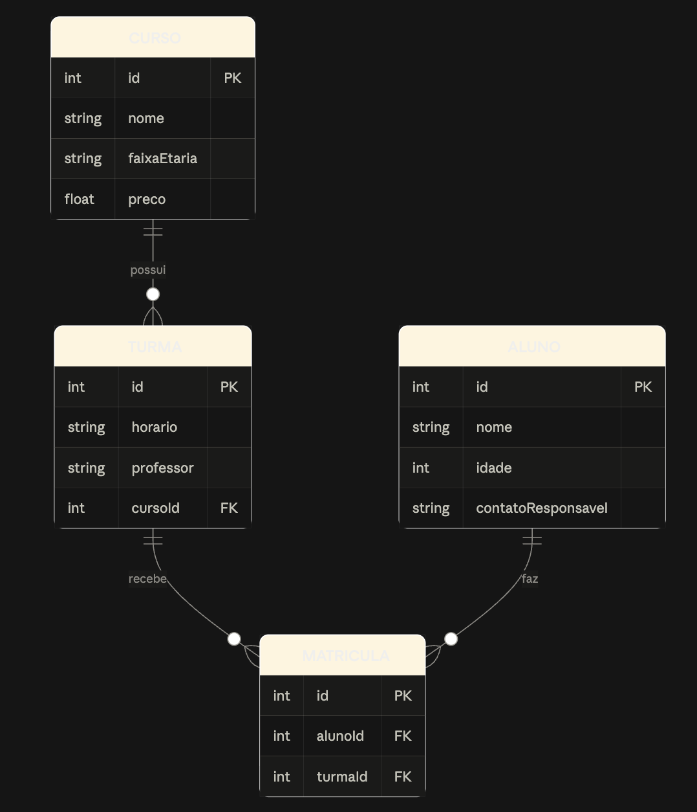

# Dionakids

Aplicação web para gerir os **cursos, turmas, alunos e matrículas** de uma escola de programação para crianças.

Projeto final do curso de desenvolvimento web da **TwoFold**.

| | Link |
|---|---|
| **App** | https://dionakids.onrender.com |
| **API (Swagger)** | https://dionakids-api.onrender.com/docs |

**Credenciais de demonstração:** `admin@dionakids.com` / `senha123`

> A app corre em planos gratuitos. Se ninguém a usar durante 15 minutos, o backend adormece e o **primeiro pedido demora cerca de 1 minuto**. Depois disso, responde normalmente.

---

## Funcionalidades

- **Autenticação:** registo e início de sessão com email e palavra-passe; as rotas são protegidas por token JWT e a sessão termina sozinha quando o token expira.
- **Dashboard:** totais de cursos, turmas, alunos e matrículas, e alunos por curso.
- **Cursos, Turmas e Alunos:** criar, listar, editar e remover.
- **Matrículas:** matricular um aluno numa turma e cancelar a matrícula.
- **Regras de negócio:** não se remove um curso com turmas, uma turma com alunos nem um aluno com matrículas; o mesmo aluno não pode ser matriculado duas vezes na mesma turma.
- **Validação** no frontend e no backend, com mensagens de erro claras.
- **Responsiva** (funciona a partir de 375 px de largura) e **acessível** (Lighthouse Acessibilidade: 100).

## Stack

| Camada | Tecnologias |
|---|---|
| Frontend | React 19, Vite, Tailwind CSS v4, React Router 7, axios |
| Backend | Node.js, Express 5, Prisma 6, bcrypt, jsonwebtoken |
| Base de dados | PostgreSQL |
| Documentação da API | OpenAPI 3 + Swagger UI |
| Testes | Jest + Supertest (backend), Vitest + React Testing Library (frontend) |
| Infraestrutura | Docker Compose, GitHub Actions (CI), Render + Neon (deploy) |

## Arquitetura

Três serviços em containers separados, ligados pelo Docker Compose:

```
Browser ──> Frontend (React, :5173) ──axios + JWT──> Backend (Express, :3000) ──Prisma──> PostgreSQL (:5432)
```

### Modelo de dados



- Um **Curso** tem várias **Turmas**.
- Uma **Matrícula** liga um **Aluno** a uma **Turma** (muitos-para-muitos), e o par aluno + turma é único.
- O **Usuario** guarda o email e o hash da palavra-passe (nunca a palavra-passe em texto).

## Como correr localmente

**Requisitos:** [Docker Desktop](https://www.docker.com/products/docker-desktop/) e Git.

```bash
git clone https://github.com/DevJoaoBarros/dionaKids-projeto-final.git
cd dionaKids-projeto-final
docker compose up --build
```

Na primeira vez demora alguns minutos. O backend espera que a base de dados esteja pronta, aplica as **migrações** e corre o **seed** sozinho, sem nenhum passo manual.

| Serviço | Endereço |
|---|---|
| App | http://localhost:5173 |
| API | http://localhost:3000 |
| Documentação da API | http://localhost:3000/docs |

Entra com `admin@dionakids.com` / `senha123`.

**Começar do zero** (apaga a base de dados local e volta a criá-la com o seed):

```bash
docker compose down -v
docker compose up --build
```

> Todos os dados do seed são **fictícios**, criados só para demonstração.

## Testes

São 25 testes automáticos: 19 no backend e 6 no frontend. Não precisam de Docker nem de base de dados, porque o Prisma e a API são substituídos por versões falsas (*mocks*).

```bash
# Backend (na raiz)
npm install
npm run lint
npm test

# Frontend
cd frontend
npm install
npm run lint
npm test
```

Em cada Pull Request, o **GitHub Actions** corre o lint e os testes do backend e do frontend, e o build do frontend. Nada entra no `main` com um check a falhar.

## Documentação da API

A documentação completa está no Swagger: [online](https://dionakids-api.onrender.com/docs) ou em http://localhost:3000/docs.

Para testar as rotas protegidas: `POST /login` → copiar o `token` → botão **Authorize** → colar.

| Recurso | Rotas |
|---|---|
| Autenticação | `POST /registo`, `POST /login` |
| Dashboard | `GET /dashboard` |
| Cursos | `GET /cursos`, `POST /cursos`, `PUT /cursos/:id`, `DELETE /cursos/:id` |
| Turmas | `GET /turmas`, `POST /turmas`, `PUT /turmas/:id`, `DELETE /turmas/:id` |
| Alunos | `GET /alunos`, `POST /alunos`, `PUT /alunos/:id`, `DELETE /alunos/:id` |
| Matrículas | `GET /matriculas`, `POST /matriculas`, `DELETE /matriculas/:id` |

Todas as rotas, exceto `/registo`, `/login` e `/docs`, exigem o cabeçalho `Authorization: Bearer <token>`. Os erros vêm sempre em JSON: `{ "erro": "mensagem" }`.

## Estrutura do projeto

```
├── index.js              # API (Express): rotas, validação e autenticação
├── prisma/
│   ├── schema.prisma     # Modelos da base de dados
│   ├── migrations/       # Migrações versionadas
│   └── seed.js           # Dados fictícios iniciais
├── tests/                # Testes do backend (Jest + Supertest)
├── docs/
│   ├── openapi.yaml      # Documentação da API
│   └── diagrama-er.png   # Diagrama entidade-relação
├── frontend/
│   └── src/
│       ├── pages/        # Login, Dashboard, Cursos, Turmas, Alunos, Matrículas
│       ├── components/   # Layout (menu), Logo, RotaPrivada
│       ├── api.js        # Cliente axios (token e endereço do backend)
│       ├── index.css     # Tema (cores e letras) e classes reutilizáveis
│       └── testes/       # Testes do frontend (Vitest)
├── Dockerfile            # Imagem do backend
├── docker-compose.yml    # Os 3 serviços
└── .github/workflows/    # CI
```

## Deploy

| Parte | Onde |
|---|---|
| Frontend | Render, Static Site (pasta `frontend`, publica `dist`) |
| Backend | Render, Web Service com o `Dockerfile` da raiz |
| Base de dados | Neon (PostgreSQL) |

Variáveis de ambiente (configuradas no Render, **nunca no repositório**):

| Serviço | Variável | Para quê |
|---|---|---|
| Backend | `DATABASE_URL` | Ligação ao PostgreSQL do Neon |
| Backend | `JWT_SECRET` | Segredo que assina os tokens |
| Frontend | `VITE_API_URL` | Endereço do backend |

Cada merge no `main` faz um novo deploy automático.

## Decisões técnicas

- **Docker Compose:** o projeto corre igual em qualquer computador com um só comando, com base de dados, migrações e seed incluídos.
- **PostgreSQL:** os dados são relacionais (curso → turmas → matrículas ← alunos) e as regras importantes (chaves estrangeiras, matrícula única) ficam garantidas pela própria base de dados.
- **Prisma:** o esquema fica num só ficheiro, as migrações ficam versionadas no Git e as consultas são legíveis. Os códigos de erro do Prisma (`P2002`, `P2003`, `P2025`) são traduzidos para respostas HTTP claras (409, 400, 404).
- **Express:** simples e suficiente para uma API REST deste tamanho; validação feita com funções próprias e testadas.
- **JWT + bcrypt:** o servidor não guarda sessões (o token traz o id do utilizador, assinado) e as palavras-passe só existem como hash. Email e palavra-passe errados dão a mesma mensagem, para não revelar que contas existem.
- **React + Vite + Tailwind:** componentes reutilizáveis, arranque rápido em desenvolvimento e um tema definido num só sítio (`index.css`), com classes próprias como `cartao`, `campo` e `botao`.
- **Testes com mocks:** os testes verificam a lógica da aplicação (validação, códigos HTTP, autenticação) em cerca de 1 segundo, sem depender de uma base de dados real.
- **GitHub Actions:** cada PR é verificado automaticamente. Já apanhou erros reais, como uma versão errada do Node no CI.
- **Swagger/OpenAPI:** documentação que se testa no browser; um teste automático falha se uma rota do código não estiver documentada.
- **Render + Neon:** deploy gratuito e sem data de expiração. A base de dados ficou no Neon porque a gratuita do Render é apagada ao fim de 30 dias.

## Processo de trabalho

- **Trello** com Backlog, Sprint, Em curso, Em revisão e Feito; cada funcionalidade tem um cartão com critérios de aceitação.
- **Uma branch e um Pull Request por funcionalidade:** nada entrou no `main` sem PR, com o CI verde.
- **Conventional Commits** (`feat`, `fix`, `test`, `docs`, `ci`, `chore`).

## Créditos e marca

Projeto final do curso de desenvolvimento web da **TwoFold**, com orientação do professor **Diogo Barros**.

A marca **"Dionakids"** e o conceito do projeto pertencem à **DIONAMITE, LDA**. Este repositório é um trabalho académico, para portefólio e aprendizagem, e **não se destina a uso comercial**.

Desenvolvido por **João Victor** ([DevJoaoBarros](https://github.com/DevJoaoBarros)).
